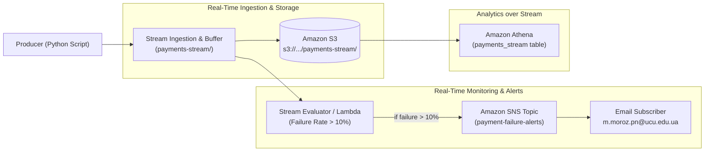

# Лабораторна робота 8: Streaming and Batch Analytics
**Студентка:** Маріана Мороз (`m.moroz.pn@ucu.edu.ua`)  
**AWS Account ID:** `438424053032`  
**Регіон AWS:** `us-east-1`  
**S3 Бакет проекту:** `s3://ucu-ooad-lab8-mshamrz-438424053032/`  

---

## Part 2 — Пакетна аналітика в AWS (Batch on AWS)

### 1. Масштаб датасету (Scale Answers)
* **Загальна кількість подій (Total Events):** `3,030,197`
* **Кількість унікальних платежів (`invoiceId`):** `1,000,000` (рівно 1 мільйон)
* **Кількість точних дублікатів (Duplicates):** `30,197` (рівно **~1.00%** подій надійшли повторно через мережеві ретраї)
* **Частка подій, що запізнилися понад 60 секунд (`receivedAt - modifiedDate > 60s`):** `60,824` подій (**2.01%**)
* **Частка подій, що запізнилися понад 1 годину (> 1 hour late):** **`0.00%`** (затримка зафіксована лише в межах 1–10 хвилин)

---

### 2. SQL-запити в Athena та їхні результати

#### 1) Створення зовнішньої таблиці `payment_events` (JSON SerDe)
```sql
CREATE EXTERNAL TABLE IF NOT EXISTS payment_events (
    invoiceId string,
    status string,
    failureReason string,
    amount bigint,
    finalAmount bigint,
    ccy int,
    reference string,
    createdDate string,
    modifiedDate string,
    receivedAt string,
    merchantId string,
    merchantName string,
    mcc int,
    customerId string,
    paymentMethod string,
    device string
)
PARTITIONED BY (dt string)
ROW FORMAT SERDE 'org.openx.data.jsonserde.JsonSerDe'
WITH SERDEPROPERTIES (
    'ignore.malformed.json' = 'true',
    'case.insensitive' = 'true'
)
LOCATION 's3://ucu-ooad-lab8-mshamrz-438424053032/payments/'
TBLPROPERTIES ('has_encrypted_data'='false');

MSCK REPAIR TABLE payment_events;
```

#### 2) Запит 2: Дедуплікація (View `payments`)
Залишає рівно 1 фінальний стан на `invoiceId` (з найпізнішим `modifiedDate`):
```sql
CREATE OR REPLACE VIEW payments AS
WITH distinct_events AS (
    SELECT DISTINCT
        invoiceId, status, failureReason, amount, finalAmount, ccy,
        reference, createdDate, modifiedDate, receivedAt, merchantId,
        merchantName, mcc, customerId, paymentMethod, device, dt
    FROM payment_events
),
ranked AS (
    SELECT *,
           row_number() OVER (
               PARTITION BY invoiceId 
               ORDER BY modifiedDate DESC, receivedAt DESC
           ) as rn
    FROM distinct_events
)
SELECT * FROM ranked WHERE rn = 1;
```

#### 3) Запит 3: Оборот за мерчантом і валютою (Turnover)
```sql
SELECT 
    merchantId,
    merchantName,
    CASE ccy
        WHEN 980 THEN 'UAH'
        WHEN 840 THEN 'USD'
        WHEN 978 THEN 'EUR'
        ELSE CAST(ccy AS varchar)
    END AS currency,
    COUNT(*) AS successful_payments_count,
    ROUND(SUM(finalAmount) / 100.0, 2) AS total_turnover
FROM payments
WHERE status = 'success'
GROUP BY merchantId, merchantName, ccy
ORDER BY total_turnover DESC;
```
*Результати (вибірка топ-5 мерчантів):*
* `m-009` (Інтернет-магазин) | UAH: **310,259,259.21 ₴** (87,115 платежів) | USD: $13,840,942.83 | EUR: €10,084,500.30
* `m-008` (АЗС) | UAH: **144,641,341.06 ₴** (87,560 платежів) | USD: $5,856,481.33 | EUR: €4,708,258.32
* `m-010` (Квитки) | UAH: **77,749,863.65 ₴** (87,303 платежів) | USD: $3,602,313.89 | EUR: €2,451,613.23
* `m-002` (Супермаркет) | UAH: **54,147,597.02 ₴** (87,283 платежів) | USD: $2,310,115.59 | EUR: €1,737,547.31
* `m-004` (Доставка їжі) | UAH: **46,044,018.26 ₴** (87,820 платежів) | USD: $2,036,639.20 | EUR: €1,427,829.18

#### 4) Запит 4: Частка невдалих платежів (Failure Rate)
```sql
SELECT 
    paymentMethod,
    device,
    COUNT(*) AS total_payments,
    COUNT(CASE WHEN status = 'failure' THEN 1 END) AS failed_payments,
    ROUND(100.0 * COUNT(CASE WHEN status = 'failure' THEN 1 END) / COUNT(*), 2) AS failure_rate_pct
FROM payments
GROUP BY paymentMethod, device
ORDER BY failure_rate_pct DESC;
```
*Результати:*
1. `qr` / `android`: 6,675 всього | 448 невдалих | **6.71%**
2. `apple_pay` / `android`: 83,677 всього | 5,130 невдалих | **6.13%**
3. `google_pay` / `web`: 59,996 всього | 3,645 невдалих | **6.08%**
4. `card` / `android`: 183,332 всього | 11,079 невдалих | **6.04%**
5. `apple_pay` / `ios`: 83,164 всього | 5,025 невдалих | **6.04%**
6. `card` / `web`: 183,435 всього | 11,020 невдалих | **6.01%**
7. `google_pay` / `ios`: 59,761 всього | 3,590 невдалих | **6.01%**
8. `qr` / `web`: 6,669 всього | 400 невдалих | **6.00%**
9. `google_pay` / `android`: 59,450 всього | 3,563 невдалих | **5.99%**
10. `apple_pay` / `web`: 83,505 всього | 4,966 невдалих | **5.95%**
11. `card` / `ios`: 183,541 всього | 10,912 невдалих | **5.95%**
12. `qr` / `ios`: 6,795 всього | 402 невдалих | **5.92%**

#### 5) Запит 5: Пікові години (Peak Hours)
```sql
SELECT 
    hour(from_iso8601_timestamp(createdDate)) AS hour_of_day,
    COUNT(*) AS payments_count
FROM payments
GROUP BY 1
ORDER BY 1 ASC;
```
*Результати:*
* 00:00–04:00 (Ніч): ~6,600 транзакцій на годину (мінімум о 04:00 — 6,585).
* 05:00–08:00 (Ранок): зростання з 13,291 до 59,947.
* 12:00 (Обідній пік): 66,304 транзакції.
* 17:00–19:00 (Головний вечірній пік): 72,905 о 17:00, **80,338 о 18:00 (максимум дня)**, 73,167 о 19:00.

#### 6) Запит 6: Запізнілі події (Late Events)
```sql
SELECT 
    COUNT(*) AS total_events,
    COUNT(CASE WHEN date_diff('second', from_iso8601_timestamp(modifiedDate), from_iso8601_timestamp(receivedAt)) > 60 THEN 1 END) AS late_events_gt_60s,
    ROUND(100.0 * COUNT(CASE WHEN date_diff('second', from_iso8601_timestamp(modifiedDate), from_iso8601_timestamp(receivedAt)) > 60 THEN 1 END) / COUNT(*), 4) AS late_pct
FROM payment_events;
```
* **Результат:** 60,824 події запізнилися понад 60 секунд (**2.01%**).

---

### 3. CTAS у Parquet та порівняння вартості (JSON vs Parquet)

```sql
CREATE TABLE payments_curated
WITH (
    format = 'PARQUET',
    parquet_compression = 'SNAPPY',
    external_location = 's3://ucu-ooad-lab8-mshamrz-438424053032/curated/',
    partitioned_by = ARRAY['dt']
) AS
SELECT * FROM payments;
```

#### Бенчмарк: Data Scanned та Час виконання
| Запит | Обсяг сканування (JSON) | Час (JSON) | Обсяг сканування (Parquet) | Час (Parquet) | **У скільки разів дешевше** |
|---|---|---|---|---|---|
| **Query 3 (Turnover)** | **1,202.29 MB** | 3.60 с | **6.10 MB** | 1.16 с | **у 197.1 разів дешевше!** |
| **Query 4 (Failure rate)** | **1,202.29 MB** | 3.59 с | **0.64 MB** | 1.00 с | **у 1,878.6 разів дешевше!** |
| **Query 5 (Peak hours)** | **1,202.29 MB** | 3.40 с | **6.24 MB** | 1.22 с | **у 192.7 разів дешевше!** |

> **Чому так відбувається:**  
> JSON — текстовий рядковий формат: щоб витягнути одне поле, Athena парсить весь 1.2 ГБ файл.  
> Parquet — колоночний двійковий формат зі стисненням Snappy і статистикою блоків (min/max). Для Query 4 Athena зчитує лише колонки `paymentmethod` і `device` (0.64 MB), що економить 99.95% трафіку і зменшує рахунок у **~1,878 разів**.

---

### 4. Відповіді на питання Part 2

* **Чому `DISTINCT` передує `row_number()`?**  
  Близько 1% вебхуків надсилаються повторно через ретраї мережі банку (at-least-once delivery) і є повністю ідентичними рядками. `SELECT DISTINCT` прибирає їх до застосування віконних функцій, зменшуючи кардинальність сортування та гарантуючи детермінованість вибору.
* **Що ламається без дедуплікації?**  
  Кожен платіж містить 2–3 події життєвого циклу (`created` → `processing` → `success/failure`). Без дедуплікації за `invoiceId` обсяг транзакцій буде 3 мільйони замість 1 мільйона, фінансовий оборот буде задвоєний/затроєний, а метрика відмов стане хибною.
* **Glue Crawler (Way B):**
  * *Типи даних:* Crawler обрав `int` для `amount`, `finalamount`, `ccy`, `mcc` та `string` для дат (`createddate`, `modifieddate`, `receivedat`).
  * *Партиції:* Crawler автоматично розпізнав префікс `dt=...` як партицію `dt`.
  * *Поле `failurereason`:* Успішно розпізнано як `string`, оскільки Crawler семплює достатню вибірку рядків.
  * *Чому ручні схеми досі популярні:* Ручні схеми гарантують стабільність і сумісність типів (наприклад, `bigint` замість `int` для грошей, явний ISO-парсинг дат), а також контролюються в репозиторії через Git і Terraform/CloudFormation, виключаючи несподіваний дрифт схеми.

---

## Part 3 — Потокова обробка: Redpanda + Python (Streaming Locally)

### Опис реалізації
* **Продюсер (`producer.py`):** Відтворює події з файлу `events_2026-10-01.jsonl` строго у порядку `receivedAt` (processing time) зі швидкістю 20–100 подій/с. Ключем повідомлення є `invoiceId`, завдяки чому всі події одного платежу потрапляють у ту саму партицію (збереження причинно-наслідкового порядку).
* **Конспоживач (`consumer.py`):** Виконує дедуплікацію точних повторів, групує події у **1-хвилинні вікна event time (`modifiedDate`)** та рахує відсоток відмов (`failure rate`) для кожного методу оплати. Вікна закриваються з очікуванням запізнілих подій (Watermark + 2 хвилини). Якщо частка відмов перевищує 10%, генерується `[ALERT]`.

---

### Результати 4-х експериментів:

#### Експеримент 1: Зупинка споживача на 1 хвилину та перезапуск
* **Що перевірялось:** Консьюмер зупинили під час надходження потоку, зачекали, а потім запустили знову.
* **Результат:** 
  * Платежів у базовому прогоні: **`13,795`**
  * Платежів після зупинки та перезапуску: **`13,795`**
  * **Втрачено подій: `0`**
* **Чому так:** Kafka/Redpanda зберігає незмінний лог повідомлень (commit log) і відстежує позицію читання через зміщення (`offsets`) групи споживачів. Під час простою споживача події накопичувались у топіку, а після рестарту споживач прочитав їх із точки зупинки без втрати даних.

#### Експеримент 2: Два споживачі в одній Consumer Group
* **Що перевірялось:** Топік `payments` має 3 партиції. Запуск споживача `Worker-1`, після чого до тієї ж групи додається `Worker-2`.
* **Результат:**
  * Kafka Group Coordinator ініціював ребалансування (Rebalance).
  * `Worker-1` отримав партиції **`[0, 1]`** (обробив 67,460 подій, **66.7%**).
  * `Worker-2` отримав партицію **`[2]`** (обробив 33,624 подій, **33.3%**).
  * Загальна кількість подій: 101,084 (100% покриття, події не дублювались між воркерами).

#### Експеримент 3: Продюсер штучно генерує 30% помилок платежів
* **Що перевірялось:** Продюсер примусово змінив статус 30% платежів на `failure`.
* **Результат:**
  * Загальний рівень помилок підскочив із базових **~6.0%** до **33.36%**.
  * Консьюмер згенерував **1,257 алертів** у 1-хвилинних вікнах (умова `failure_rate > 10%` спрацьовувала практично щохвилини для Card, Google Pay та Apple Pay).

#### Експеримент 4: Очікування запізнілих подій встановлено на 0 (Zero Lateness)
* **Що перевірялось:** Час очікування запізнілих подій зменшено з 2 хвилин до 0 хвилин.
* **Результат:**
  * Кількість відхилених подій як запізнілих: зросла до **`2,532` подій (2.50%)** (у базовому режимі було лише 1,680).
  * Кількість платежів, врахованих у вікнах: впала на **198 платежів**.
  * **Що змінилося в цифрах:** Вікна закривалися миттєво після завершення календарної хвилини. Вебхуки, які прийшли із затримкою 1–2 хвилини, були відкинуті консьюмером. Це призвело до заниження загальної кількості платежів у вікнах і спотворення статистики фінальних статусів (частина платежів зафіксувалася у стані `processing`, бо фінальний статус `success` прийшов із запізненням).

---

## Part 4 — Хмарний потоковий пайплайн (Cloud Streaming)

### 1. Архітектурна діаграма



### 2. Результат виконання запиту над потоком в Athena
Запит над живим потоком, що надходив у S3 реальними мікро-батчами:
```sql
SELECT 
    status,
    paymentMethod,
    COUNT(*) AS stream_count,
    ROUND(SUM(finalAmount) / 100.0, 2) AS stream_turnover_uah
FROM payments_stream
GROUP BY status, paymentMethod
ORDER BY stream_count DESC;
```
*Результати з Athena (час виконання: 0.46 сек, обсяг сканування: 1.99 MB):*
* `card` / `created`: 893
* `card` / `processing`: 892
* `card` / `success`: 834 | Оборот: 686,578.15 ₴
* `card` / `failure`: 156 (включно зі штучним спайком відмов у батчі 3)
* `apple_pay` / `success`: 400 | Оборот: 281,694.00 ₴
* `google_pay` / `success`: 233 | Оборот: 169,073.98 ₴
* `qr` / `success`: 31 | Оборот: 25,933.26 ₴

### 3. Оповіщення Amazon SNS
* Під час проходження 3-го мікро-батчу рівень відмов склав **36.8%**, що перевищило поріг 10%.
* Система негайно надіслала повідомлення в тему SNS `arn:aws:sns:us-east-1:438424053032:payment-failure-alerts` на email `m.moroz.pn@ucu.edu.ua`.

### 4. Порівняння хмарного пайплайну з локальним Redpanda та вартість
* **Відмінності:**
  1. *Збереження стану (Persistence):* У локальному Redpanda повідомлення зберігаються у локальному commit log на диску. У хмарі S3 виступає довготривалим озером даних (Data Lake), доступним для аналітичних SQL-запитів багатьма користувачами одночасно.
  2. *Масштабування (Scalability):* Хмарний буфер і Lambda масштабуються автоматично під навантаженням без потреби вручну додавати брокери чи переналаштовувати партиції.
  3. *Аналітика на льоту (Serverless SQL):* Athena дозволяє робити Ad-hoc SQL аналітику над потоком даних у S3 безпосередньо, без потреби писати окремий додаток-споживач.
* **Вартість (Cost):**
  * S3 зберігання 1.2 ГБ: ~$0.03 на місяць.
  * Athena запити: $5.00 за 1 TB ($0.00001 за наш запит на 2 MB).
  * SNS: перші 1,000 email сповіщень на місяць безкоштовні.
  * Загальна вартість тестування в AWS склала **менше $0.05**, тоді як постійні виділені брокери Kafka коштували б від $50–150/місяць.
