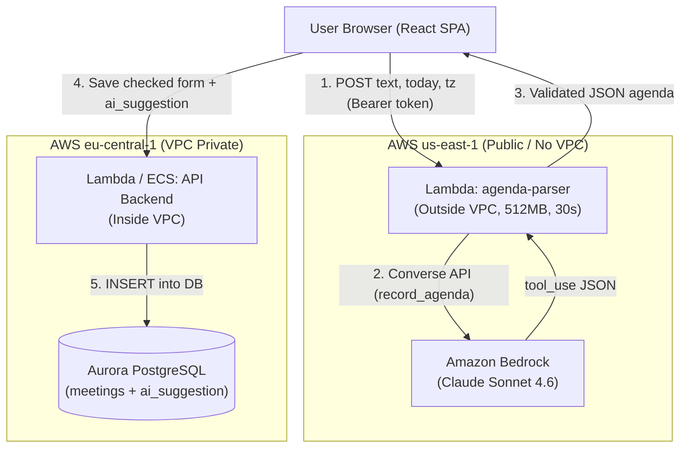

# 0006. LLM-based Agenda Parsing (Paste an Agenda)

## Context
Користувачі Spry зазвичай отримують адженди зустрічей у вигляді неструктурованого тексту (листи від менеджерів, повідомлення в Slack/Teams, нотатки). Введення цих даних вручну в окремі поля форми є повільним. Функція «Paste an agenda» дозволяє користувачеві вставити сирий текст, розпарсити його за допомогою LLM у структуровану адженду, перевірити автозаповнену форму та зберегти її.

**Архітектурні обмеження:**
1. **No NAT / No VPC endpoint overhead:** Бекенд Spry знаходиться у VPC без NAT Gateway. Доступ до хмарних сервісів поза VPC або створення VPC Interface Endpoints коштує грошей (~$7.30/міс за кожен ендпоінт).
2. **Cost & Idle Efficiency:** Система не повинна генерувати витрат, коли нею ніхто не користується ($0 at idle).
3. **Зовнішній неперевірений текст (Untrusted input):** Текст адженди надходить ззовні та може містити prompt injection або некоректні дані.
4. **Data Integrity & Human-in-the-loop:** Модель не має права самостійно записувати або змінювати дані в базі даних.

---

## Decision

1. **Модель:**
   - Обрано **Claude Sonnet 4.6** (`us.anthropic.claude-sonnet-4-6`) через Amazon Bedrock Converse API з можливістю перемикання на **Claude Haiku 4.5** для зниження вартості.
   - Виклик моделі налаштовано через структурований інструмент `record_agenda` із чіткою Pydantic-схемою (`ParsedAgenda`).

2. **Парсер як окрема Serverless Lambda поза VPC:**
   - Lambda-функція `agenda-parser` розгорнута **поза VPC**. Вона не має підключення до бази даних і їй не потрібен доступ до приватних ресурсів.
   - Оскільки функція поза VPC, вона має прямий доступ до Amazon Bedrock через інтернет без необхідності NAT Gateway чи VPC Interface Endpoint.
   - При відсутності трафіку вартість становить **$0**.

3. **Розділення обов'язків (The model never writes):**
   - Lambda парсера має єдину функцію: прийняти текст -> викликати Claude -> провалідувати схему -> повернути JSON.
   - Збереження адженди відбувається через стандартний валідований API-ендпоінт (`POST /api/meetings`), який працює у VPC і записує дані в Aurora PostgreSQL.
   - Користувач залишається «human-in-the-loop»: він бачить пропозицію моделі (позначену бейджами `suggested`), має змогу скоригувати будь-яке поле і лише після цього зберігає зустріч.
   - Поряд з аджендою зберігається `ai_suggestion`, що дає можливість збирати аналітику якості без додаткових опитувань користувача.

---

## Architecture Diagram (C4 Level 2 Container)

---

## Alternatives Considered

1. **Виклик Bedrock безпосередньо з основного API всередині VPC:**
   - *Чому відхилено:* Оскільки основний API знаходиться у VPC без NAT, для виклику Bedrock був би потрібен VPC Interface Endpoint (`com.amazonaws.us-east-1.bedrock-runtime`). Кожен такий ендпоінт коштує ~$7.30/місяць незалежно від наявності трафіку, що порушує вимогу «$0 at idle».

2. **Пряме використання Anthropic Claude API (замість Bedrock):**
   - *Чому відхилено:* Потребує зберігання та керування зовнішніми API-ключами, окремого білінгу поза AWS та сплати за індивідуальними тарифами. Bedrock дозволяє автентифікацію через IAM Role без API-ключів, єдиний рахунок AWS та можливість використання VPC/Private endpoints за потреби.

3. **Традиційний парсер на регулярних виразах (Regex / rule-based):**
   - *Чому відхилено:* Регулярні вирази занадто крихкі для реальних текстів (багатомовність, довільний порядок пунктів, скорочення, розмовні відносні дати на зразок «наступного вівторка після обіду»). Підтримка правил для сотень форматів швидко стає непідйомною.

---

## Consequences

- **Вартість за парс:** Одне виконання парсингу Claude Sonnet 4.6 коштує приблизно **$0.007–$0.008** (~1400 input tokens, ~250 output tokens). Для Claude Haiku — лише **$0.002–$0.0028**. При нульовому навантаженні вартість інфраструктури становить **$0**.
- **Логування та аудитованість:** Кожен запит логує в CloudWatch JSON-подію з ідентифікатором користувача (`sub`), моделлю, версією промпту, токенами, тривалістю виконання (`latency_ms`) та оцінкою вартості (`cost_usd`).
- **Стійкість до відмов (Bedrock down):** Якщо Amazon Bedrock недоступний або повертає помилку/ліміт (HTTP 429/502), користувач отримує чітке повідомлення про помилку й завжди може ввести адженду вручну у звичайну форму. Решта функціоналу Spry (створення зустрічей, звіти, автентифікація) продовжує працювати безперебійно.
